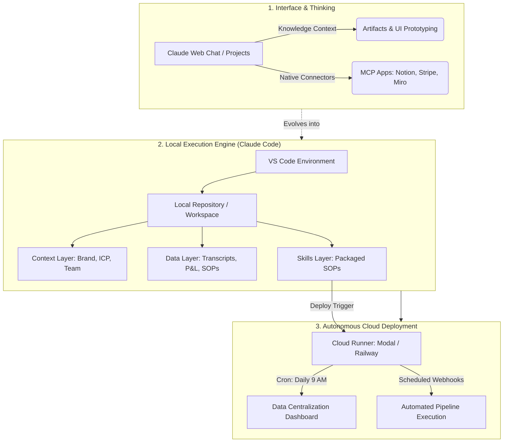

---
tags:
  - moc
  - ai-systems
  - aios
  - claude-code
  - mcp
  - automation-architecture
up: "[[00 - Laxman AI Systems Hub]]"
related:
  - "[[01 - Content Engine]]"
  - "[[02 - Design and Build Stack]]"
  - "[[Ai system]]"
sticker: lucide//venetian-mask
---
# ⚡ Masterclass Breakdown: Building an Enterprise AIOS & Agentic Workflows with Claude Code

> **Source**: Michele Torti — *57 Minutes of AI training that will explode your business in 2026*  
> **Core Premise**: AI does not just generate text—it can **build systems** and **operate systems simultaneously**. The leverage shift for operators is moving from prompt engineering to delegating full-cycle business processes to agentic systems.

---

## 🗺️ High-Level System Architecture



---

## 🧩 Architectural Foundations & Terminology

| Component | Definition | System Function | Real-World Role |
| :--- | :--- | :--- | :--- |
| **LLM (Brain)** | Frontier foundation model (Claude 3.5 Sonnet / Opus). | Cognitive reasoning, language synthesis, code generation. | The engine of the car. |
| **Agent** | LLM granted permission to take action through tools. | Non-deterministic execution (determines *how* to achieve a goal). | The driver executing the route. |
| **API** | Software-to-software communication interface. | Programmatic bridge allowing apps to exchange data. | The road network. |
| **MCP** | Model Context Protocol. | Universal connector standard linking AI models to tools. | The standardized universal electrical plug. |
| **Claude Code** | CLI / VS Code autonomous developer agent. | Reads file trees, modifies codebase, executes terminal commands. | The dedicated software engineer on your local machine. |

---

## ⚖️ Claude Web Projects vs. Claude Code Skills

| Dimension | Claude Projects (Web) | Claude Code Skills (Local/Global) |
| :--- | :--- | :--- |
| **Environment** | Cloud chat sandbox (`claude.ai/projects`). | Local repository root (`.claude/skills/`). |
| **Operational Limit**| Conversational analysis; cannot touch local file systems. | Full terminal access; executes scripts and modifies directories. |
| **Tool Integration** | Limited to pre-configured MCP web connectors. | Unrestricted API endpoints, shell executions, and database queries. |
| **Trigger Mechanism**| Manual prompt injection. | Modular slash command (`/skill-name`) callable anywhere. |
| **Persistence** | Auto-updating conversational memory. | Version-controlled code and declarative markdown SOPs. |

---

## 🏛️ The AIOS Directory Structure (Claude Code)

To build a reliable local AI Operating System (AIOS), the root directory must decouple **Context**, **Data**, and **Functions**:

```text
aios-root/
├── .claude/
│   └── skills/                       # Executable SOPs
│       ├── deal-analyzer/
│       │   └── skill.md              # Trigger: /deal-analyzer
│       ├── call-auditor/
│       │   └── skill.md              # Trigger: /call-auditor
│       └── competitor-intelligence/
│           └── skill.md              # Trigger: /competitor-intelligence
├── context/                          # Foundational Mental Models (Low update frequency)
│   ├── 01_founder_operating_principles.md
│   ├── 02_icp_and_offer_architecture.md
│   ├── 03_brand_voice_and_guidelines.md
│   └── 04_team_structure_and_roles.md
├── data/                             # Ground Truth Records (High update frequency)
│   ├── call_transcripts/
│   ├── financials_pnl/
│   ├── sop_library/
│   └── raw_analytics/
├── dashboards/                       # Vibe-coded internal tools
│   ├── app.py / index.html
│   └── server.js
├── mcp.json                          # Local MCP bridge definitions
└── .env                              # Sandboxed API secrets
```

### The Three AIOS Core Layers
1. **Context Layer (Identity)**: Establishes boundaries, target customer profiles, pricing structures, and communication nuances. Without context, agent outputs degenerate into generic content.
2. **Data Layer (Ground Truth)**: Real sales transcripts, customer objections, financial figures, and historical performance logs.
3. **Decisions Layer (Second Brain)**: Documented past operational decisions. Training the model on *why* previous choices were made allows it to mimic executive judgment.

---

## ⚡ The SPARK Automation Framework

Use this five-phase framework to convert any manual business bottleneck into an autonomous background workflow:

```
[S] Systemize ──► [P] Plugin ──► [A] Act ──► [R] Repeat ──► [K] Keep Running
```

### 1. Systemize (Visual Mapping)
* Map the entire manual process on a canvas or whiteboard before writing a single line of code.
* Identify human handoffs, tool transitions, and decision branches.
* Filter targets using the **Impact vs. Effort Matrix**:
  * *High Impact / Low Effort*: Start here (e.g., Sales call transcription audits).
  * *High Impact / High Effort*: Build second (e.g., Real-time multi-platform dashboard).
  * *Low Impact / Low Effort*: Defer.
  * *Low Impact / High Effort*: Eliminate.

### 2. Plugin (API Verification)
Query the model to evaluate the toolstack's programmatic surface area:
> *"Does [Tool Name] have an open API available? List all programmatic actions it supports across Create, Read, Update, and Delete (CRUD)."*

* **Legacy Systems Without APIs**:
  1. Break the flow into hybrid steps (AI runs Part 1 $\to$ manual human bridge $\to$ AI runs Part 2).
  2. Implement Computer Use / OS-level browser automation only as a last resort.

### 3. Act (Interactive Tuning)
* Run the workflow manually inside Claude Code.
* Iterate interactively on test inputs until the output matches executive-grade standards.
* Ensure output prompts follow **Markdown Structural Hierarchy**:
  * `# Role & Objective`
  * `## Strict Guardrails`
  * `### Evaluation Criteria`
  * `### Input Format / Reference Schema`

### 4. Repeat (Skill Packaging)
Package the dialled prompt into a permanent skill file within `.claude/skills/[skill-name]/`:
```markdown
# Skill: Deal Analyzer
Description: Evaluates incoming real estate/startup deal decks against internal ROI criteria.
Inputs: Raw pitch deck text, financial P&L export.
Steps:
1. Parse revenue run-rate and customer churn.
2. Cross-reference metrics against context/02_icp_and_offer_architecture.md.
3. Output risk-weighted score (1-100) and red flags list.
```
* **Global Portability**: Instruct Claude Code: *"Make this skill global across all workspaces in my Claude configuration."*

### 5. Keep It Running (Cloud Runner Deployment)
* Run skills beyond the local terminal by deploying them to serverless execution environments (e.g., **Modal** or **Railway**).
* Set scheduled CRON jobs (e.g., run every weekday at 09:00 AM) to pull data, run agent logic, and post updates without requiring manual machine boot-up.

---

## 🛠️ Practical Production Builds

### 1. The Autonomous Sales Call Audit Engine
* **Problem**: Reviewing 50+ sales calls consumes 20+ hours of founder time weekly.
* **Architecture**:
  ```text
  Call Recorded (Fathom/Gong) ──► Transcript Webhook ──► Claude Code Skill ──► Markdown Evaluation Report ──► Slack / Notion
  ```
* **Execution**: Single skill assessing reps against objection-handling frameworks, auto-scoring compliance, and logging coaching notes.

### 2. Vibe-Coded Unified Data Dashboard
* **Problem**: Fragmented data tracking across Stripe, Typeform, YouTube, and Notion.
* **Implementation Flow**:
  1. Connect MCP connectors or API tokens for all four services in Claude Code.
  2. Prompt Claude Code:
     > *"Query the past 6 months of metrics across Stripe (MRR/Net), Typeform (qualified leads), YouTube (impressions/retention), and Notion (calls booked). Build a lightweight web dashboard displaying daily velocity, blended acquisition cost, and a chat interface ('Ask AIOS') to interrogate this dataset."*
  3. Deploy the resulting code to Modal with a midnight CRON refresh trigger.

---

## 🔗 Direct Vault Integration Map

* **Link to [[01 - Content Engine]][span_0](start_span)[span_0](end_span)**:
  * Implement the Markdown Hierarchy Rule directly into [[google-spark-daily-content-brief-prompt]][span_1](start_span)[span_1](end_span) and [[laxman_voice_profile_full]][span_2](start_span)[span_2](end_span) to eliminate prompt ambiguity.
  * Model the content production chain in [[All_in_one_file_]][span_3](start_span)[span_3](end_span) after the SPARK framework (Systemize $\to$ Act $\to$ Repeat via `/skills`).
* **Link to [[02 - Design and Build Stack]][span_4](start_span)[span_4](end_span)**:
  * Add the Claude Code CLI, MCP protocols, and Modal deployment layers into [[Ai system]][span_5](start_span)[span_5](end_span).
  * The Vibe-Coded Master Dashboard provides a ready template for [[5 Projects That Teach You More Than Your Degree]][span_6](start_span)[span_6](end_span).
* **Link to [[00 - Laxman AI Systems Hub]][span_7](start_span)[span_7](end_span)**:
  * Anchor this note under a new operational header: **Agentic Infrastructure & AIOS**.

---
**LAXMAN MEGHWAL** · Laxman AI Systems
